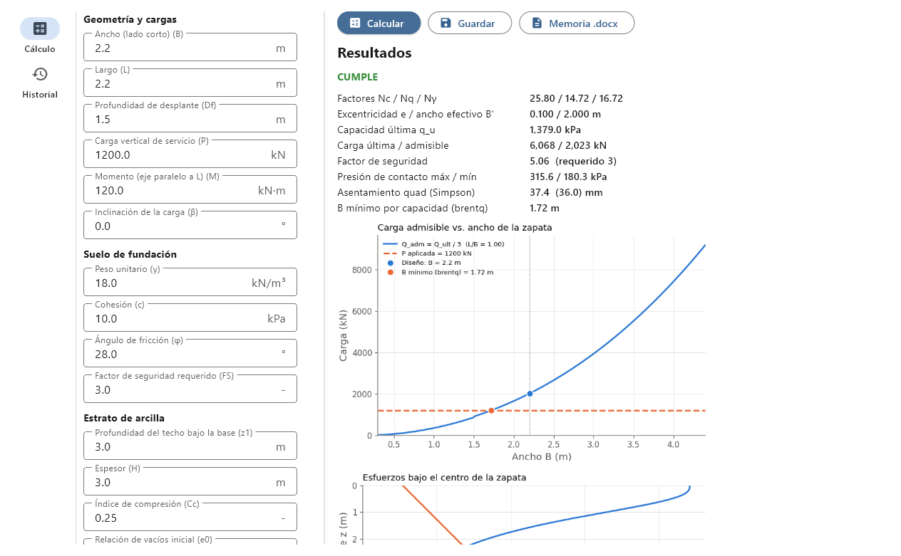
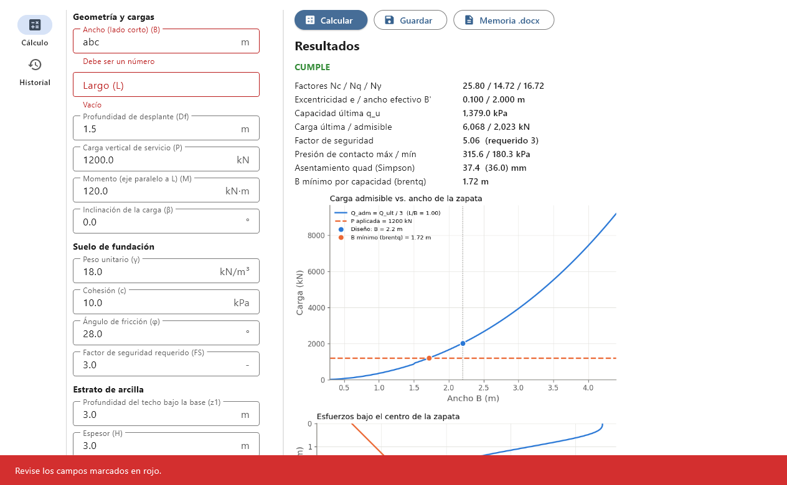
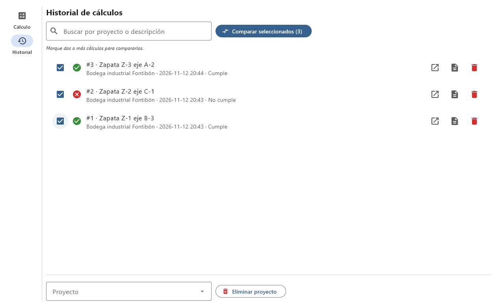
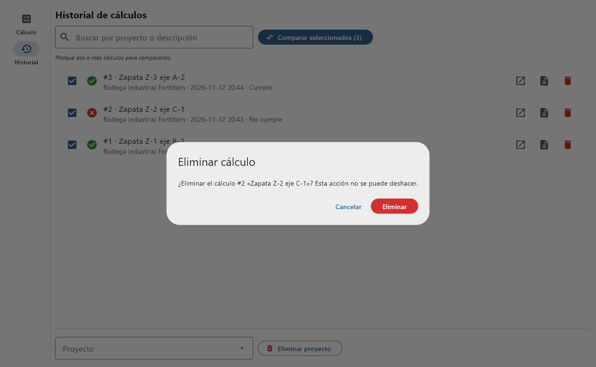
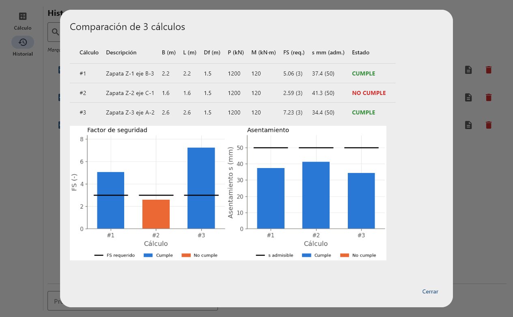

# Cimentaciones superficiales: capacidad portante y asentamiento

Aplicación de escritorio para diseñar y revisar **zapatas rectangulares aisladas**:
calcula la capacidad portante con la ecuación general de capacidad de carga, el
asentamiento por consolidación de un estrato de arcilla, el ancho mínimo que cumple
el factor de seguridad, guarda los cálculos por proyecto y genera la **memoria de
cálculo en Word**.

Proyecto 02 de Programación II (Grupo 18), Ingeniería Civil, Universidad Distrital Francisco José de Caldas, 2026-III.

Repositorio: https://github.com/DanielBuitrago654/cimentaciones-superficiales



## 1. Problema que resuelve

Para dimensionar una zapata el ingeniero debe verificar dos cosas:

1. **Falla por capacidad portante**: la carga última del suelo dividida entre la carga
   de servicio debe ser al menos el factor de seguridad (FS ≥ 3, NSR-10 H.4.7).
2. **Asentamiento**: el asentamiento de los estratos compresibles no debe superar el
   admisible.

A mano esto exige leer factores en tablas, repetir el cálculo para cada ancho de
prueba y promediar esfuerzos en el estrato. La aplicación lo hace de forma
vectorizada y deja todo documentado.

## 2. Fundamento teórico

### 2.1 Capacidad portante (Das, cap. 3)

$$q_u = c\,N_c F_{cs}F_{cd}F_{ci} + q\,N_q F_{qs}F_{qd}F_{qi} + \tfrac{1}{2}\gamma B' N_\gamma F_{\gamma s}F_{\gamma d}F_{\gamma i}$$

| Término | Expresión | Autor |
|---|---|---|
| Factores de capacidad | $N_q=\tan^2(45°+\phi/2)\,e^{\pi\tan\phi}$, $N_c=(N_q-1)\cot\phi$, $N_\gamma=2(N_q+1)\tan\phi$ | Vesić (1973) |
| Forma | $F_{cs}=1+\frac{B}{L}\frac{N_q}{N_c}$, $F_{qs}=1+\frac{B}{L}\tan\phi$, $F_{\gamma s}=1-0.4\frac{B}{L}$ | De Beer (1970) |
| Profundidad | $F_{qd}=1+2\tan\phi(1-\sin\phi)^2 k$, con $k=D_f/B$ si $D_f/B\le1$ y $k=\arctan(D_f/B)$ si no | Hansen (1970) |
| Inclinación | $F_{ci}=F_{qi}=(1-\beta/90°)^2$, $F_{\gamma i}=(1-\beta/\phi)^2$ | Meyerhof y Hanna (1981) |
| Excentricidad | $e=M/P$, $B'=B-2e$, $Q_{ult}=q_u B' L$ | Meyerhof (área efectiva) |

Las presiones de contacto se calculan con flexión compuesta $q=P/A \pm M c/I$, con
el área y la inercia de la planta obtenidas con **pysections**. Si $e>B/6$ se usa la
distribución triangular $q_{max}=4P/[3L(B-2e)]$: parte de la base se despega ($q_{min}=0$).
La app y la memoria lo informan como **advertencia** y no como incumplimiento, porque la
capacidad portante ya se calcula con el área efectiva $B'=B-2e$.
También se informa, como advertencia, si la presión máxima de contacto supera la presión
permisible: $q_{max} \le q_u/FS$ (Das, ec. 3.12).

### 2.2 Asentamiento por consolidación (Das, cap. 5)

El incremento de esfuerzo bajo el centro se obtiene con la solución de Boussinesq
para un rectángulo (cuatro esquinas, factor de Newmark) y el asentamiento de la
arcilla normalmente consolidada se **integra en todo el espesor**:

$$s=\int_{z_1}^{z_1+H}\frac{C_c}{1+e_0}\log_{10}\frac{\sigma'_0(z)+\Delta\sigma(z)}{\sigma'_0(z)}\,dz,\qquad q_{neta}=\frac{P}{BL}-\gamma D_f$$

### 2.3 Métodos numéricos y por qué se eligieron

| Método | Dónde | Justificación |
|---|---|---|
| `scipy.integrate.quad` | `asentamiento_quad` | Δσ decae de forma no lineal con z; integrar la deformación es más preciso que el promedio de Simpson de tres puntos que usa Das (se muestran ambos para comparar). |
| `scipy.optimize.brentq` | `ancho_minimo` | Halla el ancho B que hace FS = FS requerido. La función FS(B) es continua y creciente, así que el método de Brent, con intervalo garantizado, converge siempre. |
| NumPy vectorizado | `factores_capacidad`, `capacidad_ultima`, `incremento_esfuerzo` | Las funciones reciben arreglos: la curva Q_adm vs B (200 anchos) y el perfil Δσ(z) (300 profundidades) se evalúan sin ciclos `for`. |

### 2.4 Hipótesis y limitaciones

- Suelo homogéneo para la capacidad portante y nivel freático profundo.
- Excentricidad en una sola dirección (a lo largo de B, que es el lado corto).
- Arcilla normalmente consolidada; no se calcula el asentamiento inmediato ni el secundario.
- El quiebre de la curva de capacidad en $D_f/B=1$ es propio de los factores de Hansen.

## 3. Validación

`pytest` corre 24 pruebas (`tests/`). Las de validación del modelo son:

| Caso | Fuente | Tolerancia |
|---|---|---|
| Nc, Nq, Nγ para φ = 0°, 20°, 30°, 35° | Das, tabla 3.3 | 0.1 % |
| Zapata corrida en arcilla: $q_u=(\pi+2)c$ | Prandtl | 0.1 % |
| Zapata cuadrada 2 × 2 m en arena, φ = 30°: $q_u$ = 839.8 kPa | Resuelto a mano (ver docstring del test) | 0.5 % |
| Presiones de contacto con pysections contra $P/A(1\pm 6e/B)$ | Fórmula clásica | exacta |
| Boussinesq: Δσ → q en la superficie y → carga puntual lejos | Límites teóricos | 1 % |
| Asentamiento con quad contra el método de Simpson de Das | Das, cap. 5 | 10 % |
| brentq: en B_min se obtiene FS = FS requerido | Definición | 0.1 % |

## 4. Instalación

Requiere Python 3.11 o superior (probado con 3.14).

```bash
git clone https://github.com/DanielBuitrago654/cimentaciones-superficiales.git
cd cimentaciones-superficiales
python -m venv .venv
# Windows:
.venv\Scripts\activate
# macOS / Linux:
source .venv/bin/activate
pip install -r requirements.txt
python main.py
```

La base de datos `datos/cimentaciones.db` se crea sola la primera vez.

## 5. Uso paso a paso

1. **Cálculo**: escriba los datos (cada campo indica su unidad) y presione **Calcular**.
   Si un campo está vacío o no es un número, se marca en rojo y aparece un aviso.
2. Revise el estado **CUMPLE / NO CUMPLE**, la tabla de resultados y las dos gráficas.
   Si $e>B/6$ aparece además una advertencia de despegue.
3. **Guardar**: elija o escriba el proyecto y una descripción del elemento (por ejemplo, «Zapata Z-1, eje B-3»).
4. **Memoria .docx**: genera la memoria del cálculo guardado en la carpeta `reportes/` y la abre.
5. **Historial**: busque por proyecto o descripción, y use los botones para **abrir** un
   cálculo en el formulario, generar su **memoria** o **eliminarlo** (pide confirmación).
   Abajo, el menú **Proyecto** y el botón **Eliminar proyecto** borran un proyecto con todos
   sus cálculos (también pide confirmación; la cascada la hace SQLite con `ON DELETE CASCADE`).
6. **Comparar**: marque dos o más cálculos en el Historial y presione **Comparar seleccionados**.
   Se abre una tabla con B, L, Df, P, M, FS y asentamiento de cada uno, y una gráfica de barras
   de FS y asentamiento con el límite de cada cálculo (útil para elegir entre alternativas).

| Validación de datos | Historial | Confirmación al eliminar |
|---|---|---|
|  |  |  |



Un ejemplo de memoria generada está en [`ejemplos/memoria_ejemplo.docx`](ejemplos/memoria_ejemplo.docx).

El modelo también se puede usar sin la interfaz:

```bash
python -m app.modelo        # imprime los resultados del ejemplo por defecto
pytest -v                   # corre las pruebas
```

## 6. Estructura del proyecto

```
cimentaciones-superficiales/
├── main.py                  # punto de entrada (ft.run)
├── requirements.txt         # versiones fijadas
├── pytest.ini
├── app/
│   ├── sections.py          # pysections, copiado SIN modificaciones (GPL-3.0)
│   ├── zapata.py            # planta de la zapata como polígono de pysections + presiones de contacto
│   ├── modelo.py            # capacidad portante, Boussinesq, asentamiento, brentq (sin Flet)
│   ├── graficas.py          # figuras de Matplotlib -> PNG (capacidad, esfuerzos, comparación)
│   ├── db.py                # SQLite: proyectos y calculos (llave foránea), CRUD parametrizado
│   ├── reporte.py           # memoria .docx con docxtpl
│   ├── comparacion.py       # tabla de comparación de varios cálculos (sin Flet)
│   └── ui/                  # Flet: aplicacion.py, vista_calculo.py, vista_historial.py, comunes.py
├── plantillas/
│   ├── memoria.docx         # plantilla Jinja propia
│   └── crear_plantilla.py   # script que generó la plantilla
├── tests/                   # test_modelo.py, test_db.py, test_reporte.py, test_comparacion.py
└── ejemplos/
    ├── memoria_ejemplo.docx
    └── capturas/
```

### Base de datos

```
proyectos (id, nombre UNIQUE, ubicacion, creado)
    1 ──< N
calculos  (id, proyecto_id FK ON DELETE CASCADE, descripcion, fecha, entradas JSON, resultados JSON, cumple)
```

### Integración de pysections

Se reutiliza [pysections](https://github.com/rvcristiand/pysections) (C. D. Ramírez Vargas, GPL-3.0).
El archivo `sections.py` se copió **intacto** en `app/`. La clase `ZapataRectangular`
(`app/zapata.py`) hereda de `_SinglePolygonSection` e implementa solo `_calculate_points`
con los 4 vértices de la planta; pysections entrega el área y la inercia `Izz`
(= L·B³/12) que se usan para las presiones de contacto. Como `sections.py` activa el
estilo `ggplot` de Matplotlib al importarse, `graficas.py` fija explícitamente el fondo blanco.
Por usar código GPL-3.0, este proyecto se distribuye con la misma licencia.

## 7. Referencias

- Das, B. M. (2012). *Fundamentos de ingeniería de cimentaciones* (7.ª ed.; J. León Cárdenas, Trad.). Cengage Learning. Traducción de *Principles of Foundation Engineering* (7th ed.).
- Vesić, A. S. (1973). Analysis of ultimate loads of shallow foundations. *J. Soil Mech. Found. Div.*, ASCE, 99(1), 45–73.
- Meyerhof, G. G. (1963). Some recent research on the bearing capacity of foundations. *Canadian Geotechnical Journal*, 1(1), 16–26.
- AIS (2010). *Reglamento Colombiano de Construcción Sismo Resistente NSR-10*, Título H.
- Ramírez Vargas, C. D. (2025). *pysections*. https://github.com/rvcristiand/pysections

## 8. Autores

| Integrante | Código | Responsabilidad principal |
|---|---|---|
| David Ernesto Bohórquez Lozano | 20242579031 | Modelo de ingeniería, pysections, gráficas, pruebas del modelo |
| Daniel Andres Buitrago Capera | 20241579042 | Base de datos, memoria docxtpl, interfaz Flet, comparación, empaquetado |

Licencia: GNU GPL v3.0 (ver `LICENSE`).
